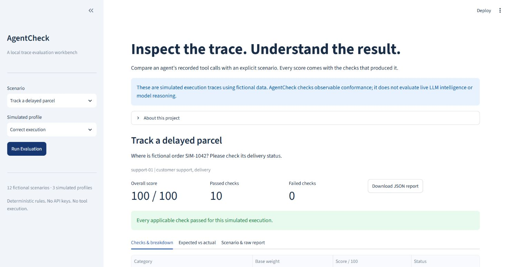
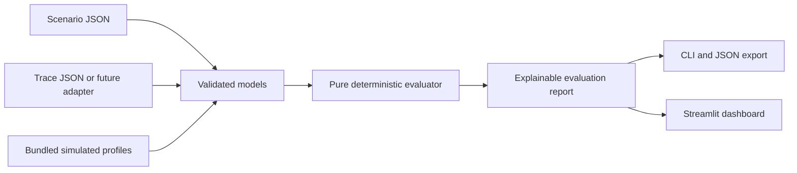

# AgentCheck

**Explainable evaluation for agent tool traces. Local, deterministic, and free to run.**

AgentCheck compares recorded tool calls and final response text with an explicit
scenario. It produces a 0–100 score, category breakdowns and actionable checks,
through a Python API, command-line interface and lightweight Streamlit dashboard.

All bundled examples are **simulated execution traces with fictional data**.
AgentCheck does not evaluate live LLM intelligence or model reasoning. Calls in a
trace are treated strictly as data and are never executed.



## Features

- Check tool selection, exact arguments, ordering, missing calls, unexpected or
  unauthorized calls, and required response text.
- Inspect every passed and failed check; export deterministic JSON reports.
- Explore 12 fictional support, order, booking, refund, handoff and retrieval
  scenarios with correct, incorrect and unauthorized simulated profiles.
- Gate local scripts or CI with a configurable score threshold and exit codes.
- Validate inputs with descriptive errors, without API keys or network services.

## Quick start

Requires Python 3.11 or newer. Installing dependencies needs package access;
evaluation and tests run locally and require no network or credentials afterward.

```bash
python -m venv .venv
# macOS / Linux
source .venv/bin/activate
# Windows PowerShell (use this instead of the line above)
.venv\Scripts\Activate.ps1

python -m pip install -e ".[dev]"
streamlit run app.py
```

Open the localhost URL printed by Streamlit. Select a scenario and simulated
profile, click **Run Evaluation**, inspect the checks and download the JSON report.
Changing a selection requires a new run so an older report cannot masquerade as
the current result. Streamlit usage telemetry is disabled in the project config.

## Command line

```bash
# Evaluate a scenario file and a trace file; save the same JSON printed to stdout.
agentcheck evaluate --scenario examples/scenario.json --trace examples/trace.json --output reports/example.json --threshold 90

# Every bundled scenario, with a perfect-execution gate.
agentcheck samples --profile correct --threshold 100 --output reports/correct.json

# Deliberately fail a gate using incorrect simulated execution.
agentcheck samples --profile incorrect --threshold 90 --output reports/incorrect.json

# Unauthorized simulated profile.
python -m agentcheck samples --profile unauthorized --output reports/unauthorized.json

# A single wrong argument (75 / 100 with the example scenario).
agentcheck evaluate --scenario examples/scenario.json --trace examples/trace_incorrect.json --threshold 80
```

Exit codes: `0` means every evaluated score meets the threshold; `1` means at
least one score falls below it; `2` means invalid input, arguments or file errors.
Thresholds must be finite numbers from 0 through 100, inclusive (default `0`).
The batch gate applies to **each scenario**, not just the mean. A score alone is
not a safety guarantee; inspect unauthorized-call checks even when a gate passes.

Sample report excerpt (the full report contains all checks and both call lists):

```json
{
  "schema_version": "1.0",
  "scenario_id": "example-01",
  "score": 75.0
}
```

This is the wrong-argument example: the tool name, order, presence, permission and
response text pass, while the 25-point arguments component fails. The evaluator
explains the expected and actual arguments. `reports/` is ignored by Git.

## Scoring rules

| Category | Base weight | Deterministic rule |
| --- | ---: | --- |
| Tool selection | 20 | Each actual call must match an unused expected tool-name occurrence. If actual calls are empty, pass only when no calls are expected. |
| Arguments | 25 | Each expected call must have a paired actual call with exactly matching typed JSON arguments. Missing calls fail. |
| Order | 15 | Paired expected indices in actual order must increase. No matched calls fails when calls were expected. |
| Missing calls | 15 | Check presence of each expected tool-name occurrence. |
| Unexpected calls | 15 | Each actual call must be paired and its name allowed. An extra allowed call still fails. An empty actual list passes this category. |
| Response text | 10 | Every required phrase must be a case-insensitive substring of the final response. |

Within an active category, its score is the fraction of checks passed. The total
is `100 × sum(base_weight × fraction_passed) / sum(active_base_weights)`, rounded
to two decimals. Categories without expectations are inactive: arguments, order
and missing calls when no calls are expected; response text when no phrases are
required. Tool selection and unexpected calls always remain active. A correct
no-tool response therefore scores 100, rather than being penalized for empty data.
Scores and thresholds use the reported two-decimal score.

Pairing walks actual calls left to right and assigns each to the first unused
expected call with the same name. Repeated tool names match **by occurrence**;
arguments do not influence pairing. Swapping two same-name calls with different
arguments fails argument checks; name-based ordering cannot distinguish them.
Order checks relative order among matched calls; missing and extra calls have
their own checks. Some mistakes affect multiple categories by design, for example
a wrong tool may also cause an expected call to be missing. This is a transparent
conformance rubric, not a calibrated probability of success.

Argument objects require exactly the expected keys and values. Object key order
does not matter; array order, case, JSON value types and extra keys matter.
Booleans differ from numbers. No fuzzy matching, semantic response grading or
argument coercion is performed. Tool names and scenario IDs are case-sensitive.
Integers and equivalent floating-point values (such as `1` and `1.0`) both represent
the JSON number type and compare equal. Report indices are zero-based; the
dashboard numbers call cards from one for readability.

## Input format and Python API

See [examples/scenario.json](examples/scenario.json) and
[examples/trace.json](examples/trace.json) for complete minimal files.
The expected call array defines ordering; each call contains `name` and an
`arguments` JSON object. A scenario requires `scenario_id`, `name`, `user_request`,
`allowed_tools` and `expected_calls`. `required_response_text` and `tags` default
to empty arrays. Traces require `scenario_id`, `actual_calls` and `final_response`.
The IDs must agree. Empty final responses are valid and can fail text checks.

Unknown fields, duplicate allowed tool names/tags, invalid types, nonfinite numbers
and expected calls outside the allowlist are rejected. Scenario IDs must be unique
within a collection; bundled data enforces this. There is no global ID registry.

```python
from agentcheck.engine import evaluate
from agentcheck.samples import load_scenarios, make_trace

scenario = load_scenarios()[0]
trace = make_trace(scenario, "incorrect")  # simulated, inert data
report = evaluate(scenario, trace)
print(report.score)
print(report.to_json())
```

## Architecture



- `src/agentcheck/models.py`: schemas, typed models and validation.
- `engine.py`: matching, checks and weighted scoring, independent of Streamlit.
- `cli.py` and `io.py`: command handling and file boundaries.
- `samples.py` and `data/scenarios.json`: packaged fictional fixtures.
- `adapters.py`: a small `TraceAdapter` protocol for future normalization.
- `app.py`: native Streamlit controls and report rendering.
- `tests/`: evaluator, input, CLI, fixture and dashboard tests.

A future adapter should normalize a provider's recorded data to the validated
`Trace` model before evaluation. It must preserve call order and argument types,
map tool names explicitly, redact private values upstream and reject unsupported
events. The protocol is only an interface: no provider SDK, live agent integration
or tool executor is implemented.

## Development and CI

```bash
pytest -q
ruff check .
ruff format --check .
python -m build
python -m compileall -q src app.py
```

The GitHub Actions workflow runs tests, lint, formatting, builds and CLI gates on
Python 3.11, 3.12 and 3.13, and checks bundled fixtures from an isolated installed
wheel. Dashboard tests use Streamlit's AppTest without a browser or service.
For a server smoke test, run `streamlit run app.py --server.headless true` and
check `http://localhost:8501/_stcore/health`; stop the process when finished.

Dependencies are bounded in `pyproject.toml`. No lockfile is supplied; resolved
versions can change across installations. Core evaluation is deterministic for
the same supported inputs, irrespective of report timestamps (there are none).

## Limitations and future work

- Fixtures verify conformance to an authored expectation, not whether a tool
  result is truthful, a policy is suitable, or a response is semantically correct.
- No tool outputs, timing, costs, parallel calls, branches, retries or alternative
  valid execution paths are modeled. All expected calls form one linear sequence.
- Required response phrases are simple substrings: negation can pass. Do not use
  this check as proof of factual or policy correctness.
- The dashboard explores bundled scenarios; custom files are supported by the CLI
  and Python API. No uploads, persistence, authentication or external analytics.
- Local JSON input is intended for normal fixture sizes, not hostile huge files.

Useful next extensions: versioned adapter fixtures, alternative allowed paths,
and richer explicit response rules. Keep these offline and testable before adding
live integrations.

## License

[MIT](LICENSE). Contributions are welcome through focused issues and pull requests;
include a failing fixture or test when reporting an evaluation bug.
